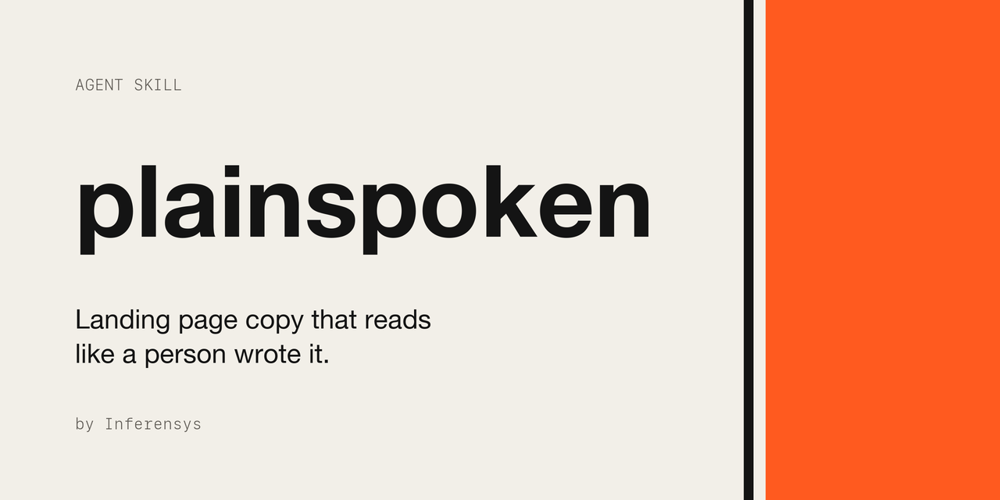

# plainspoken

An agent skill for writing landing page copy that reads like a person wrote it, and converts.

Most AI-written marketing copy fails the same way: there are no facts behind it, so the model fills the gap with tone. You get "seamless solutions", "built for real users", "not just X, it's Y", and a headline any competitor could put on their own site. Buyers have read thousands of these lines and skip them.

plainspoken makes Claude work the way a good conversion copywriter does. It collects the facts first. It settles positioning before it writes a line. Every claim gets proof placed next to it. When a fact is missing, it leaves a visible placeholder and asks you, instead of inventing a number.

It works for any homepage or landing page. It's tuned for B2B services firms, agencies, consultancies and technical products sold to expert buyers.

## What it does

- **Writes or rewrites a page.** You get a short positioning brief, the copy section by section, 2–3 headline options with the angle of each, and a list of the facts it still needs from you.
- **Critiques existing copy.** It goes line by line, names the problem ("no proof", "a competitor could say this", "label instead of claim", "salesy CTA"), says which fact would fix it, and ranks the fixes by impact.
- **Lints a draft.** `scripts/lint_copy.py` flags the mechanical tells:
  - stock and AI words
  - presumptive intensifiers ("real", "actually", "already")
  - redundant qualifiers ("your existing", "your own")
  - antagonistic framing ("unlike other agencies", "no fluff")
  - not-X-but-Y contrasts, staged run-ups and one-line closers
  - dashes, Title Case headings, and inconsistent CTA labels
  - reading grade and sentence rhythm

## Install

**Claude Code (plugin marketplace)**

```
/plugin marketplace add inferensys/plainspoken
/plugin install plainspoken@inferensys
```

**Any agent that supports skills ([skills.sh](https://skills.sh))**

```bash
npx skills add inferensys/plainspoken
```

**Manual**

Copy `skills/plainspoken` into `~/.claude/skills/` to use it in every project, or into `.claude/skills/` to use it in one repo.

**Claude.ai**

Zip the `skills/plainspoken` folder and upload it under Settings → Capabilities → Skills.

## Use it

The skill triggers on its own when you ask for website copy. For example:

- "Rewrite our homepage hero. Here's the current page and two case studies."
- "Critique the copy on pricing.html. It sounds generic."
- "Give me CTA labels for a 30-minute discovery call."
- "Write a landing page for our RAG consulting service. We sell to CTOs."

Expect questions before you get copy: which client result you can name, what an engagement costs, who takes the first call, and what you turn down. Those answers decide whether the copy sounds human.

## What's inside

```
skills/plainspoken/
├── SKILL.md                     workflow, element rules, voice, output format
├── references/
│   ├── positioning-brief.md     voice-of-customer mining, positioning, awareness stages, brief template
│   ├── elements.md              hero, subhead, headings, body, proof, process, FAQ, forms, with real examples
│   ├── proof-and-ctas.md        proof formats, risk reversal, CTA intent ladder, CTA labels
│   ├── ai-tells.md              catalogue of generic and AI-sounding patterns, with fixes
│   └── sources.md               the research behind the rules
└── scripts/
    └── lint_copy.py             mechanical tell checker (Python 3, no dependencies)
```

## Where the rules come from

The method draws on Joanna Wiebe (Copyhackers), April Dunford, Eugene Schwartz, Peep Laja (Wynter), Harry Dry (Marketing Examples), Julian Shapiro, Eddie Shleyner, Ann Handley and David Ogilvy. The data comes from the Unbounce Conversion Benchmark and Nielsen Norman Group reading research. The AI-tell patterns build on Wikipedia's [Signs of AI writing](https://en.wikipedia.org/wiki/Wikipedia:Signs_of_AI_writing). Examples are taken from a teardown of about 20 services and dev-tool websites. Links are in [`sources.md`](skills/plainspoken/references/sources.md).

## Contributing

Issues and pull requests are welcome, especially:
- before/after examples from real pages
- new tells with a clear fix
- false positives in the linter

## License

MIT. Made by [Inferensys](https://inferensys.com).
